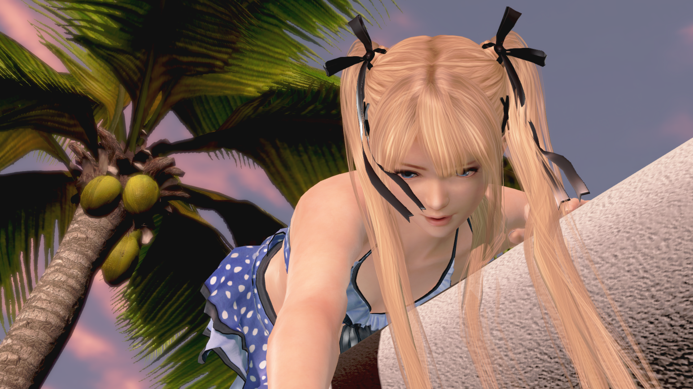
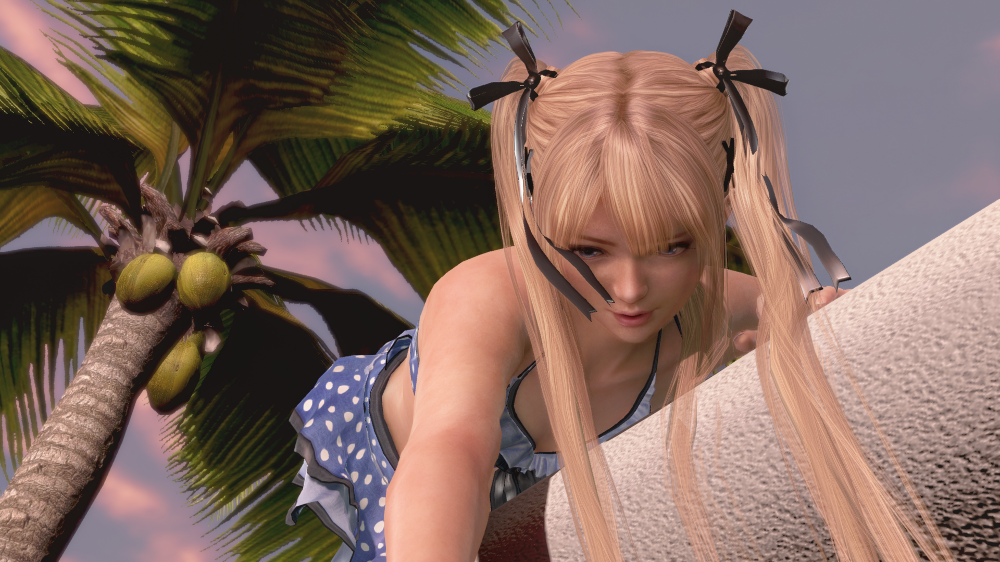
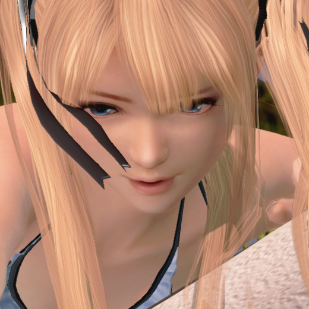
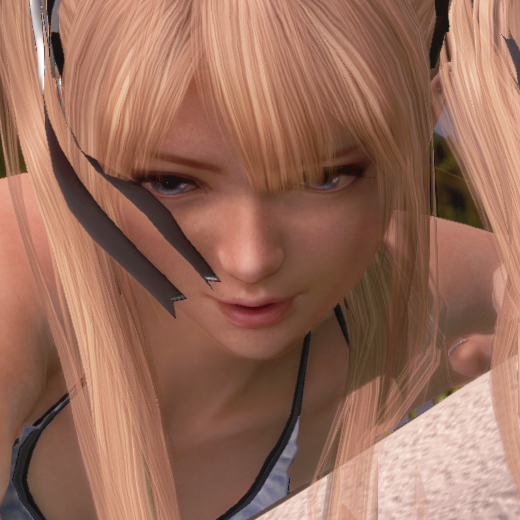
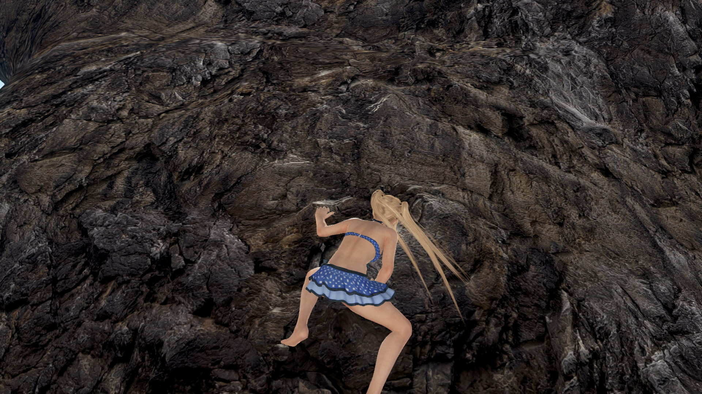
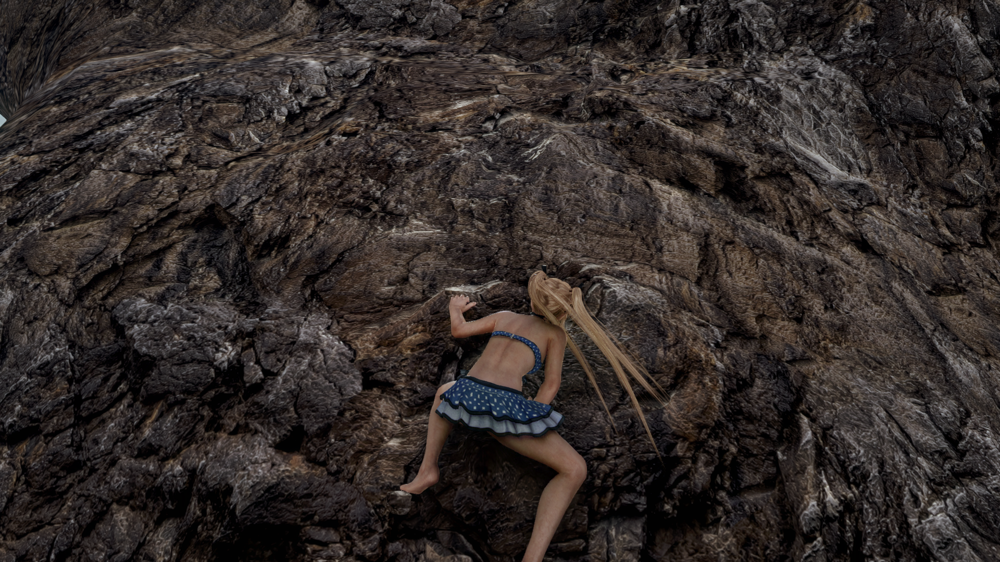
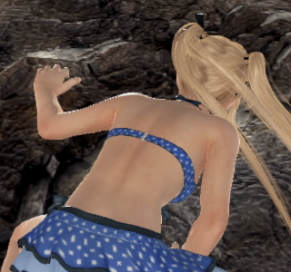
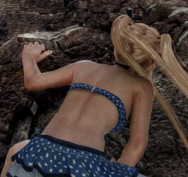

# Fortune: native scene / NR comparisons

These are actual game render buffers from Fortune **CUSA04555 01.19** on an
RTX 5090. The experimental Feature 18 integration is the path called the
“DLSS5 mod” in this project; see [setup and tested runtime hashes](neural-rendering.md).
Both examples use 1920×1080 color, depth and camera/object-motion guides,
NR strength 1 and a 30 FPS cap. Frame generation is disabled.

## Poolside Relax camera

Smoke run `fortune-119-readme-nr-comparison-17`, started **2026-10-26 18:56:42 UTC**;
pair `nr_002`, requested 235 seconds after launch. This close-up is from the
pool animation before water entry, rather than Photo Paradise. The new repository's
rebuilt Fortune host completed the 300-second run with exit code 0; the final
periodic counter reported 6,300 guided frames and 6,300 successful NR evaluations.

| Native scene / NR input | Same frame after NR |
|---|---|
|  |  |

| Native face detail | NR face detail |
|---|---|
|  |  |

Identical crop: `(960, 300)` to `(1480, 820)`, 520×520 source pixels.
[Capture provenance, raw/PNG hashes and settings](screenshots/comparisons/poolside-camera/capture.json).
The visible differences include darker facial shading and finer skin texture;
NR also changes the appearance of facial features and hair.

## Rock Climbing

Smoke run `fortune-119-rock-return-16`, pair `nr_000`, requested 300 seconds
after launch. This earlier development-host run completed Rock Climbing and
returned to the daytime map. Its exact host and runtime hashes are recorded
separately from the newer pool run.

| Native scene / NR input | Same frame after NR |
|---|---|
|  |  |

| Native shoulder / arm detail | NR shoulder / arm detail |
|---|---|
|  |  |

Identical crop: `(825, 495)` to `(1145, 795)`, 320×300 source pixels.
[Capture provenance, raw/PNG hashes and settings](screenshots/comparisons/rock-climbing/capture.json).

## How the pairs were made

The capture hook in
[vk_doax3_neural.cpp](../source/gpu/shadps4/video_core/renderer_vulkan/vk_doax3_neural.cpp)
copies scene color immediately before and after the in-place NR evaluation.
The two images therefore have the same animation time, pose, camera and exposure
input. They precede UI composition. “Native” means the input scene buffer;
it is not a separately launched NR-disabled session or its temporal history.

The legacy raw filenames say `rgba8`, but this VideoOut path stores **BGRA8**.
The exporter decodes that byte order to lossless RGB PNG and applies the same
integer crop to each side. It adds no resampling, sharpening, retouching or
color grading. GitHub may scale previews; open/download each PNG for 100% inspection.

To export your own already-recorded pair, install the optional documentation
dependencies and use the included helper (the raw captures are not distributed):

```powershell
python -m pip install Pillow numpy
python tools/Export-NR-Comparison.py --capture "C:/Captures/my-run" --prefix nr_002 --name my-pool-comparison --description "My matched pool camera pair" --crop face:960,300,1480,820
```

The capture directory must contain the two raw buffers, `run.json` and
`stdout.log` from an NR-enabled run. The exporter rejects identical buffers and
runs without successful NR log evidence; it refuses to overwrite an existing
comparison directory. Each `capture.json` includes source/output hashes,
settings and crop coordinates, without local machine paths or DLL payloads.

The pixel-difference values are sanity checks, not quality scores. NR can
relight and reinterpret detail; added skin texture is not proof of original
game texture recovery. Static pairs do not establish flicker, ghosting or
temporal stability. Existing water/streamout limitations still apply.

See also the [Scarlet Poolside Relax portrait](https://github.com/negroISO/doax3-scarlet-pc/blob/main/docs/nr-comparisons.md).
